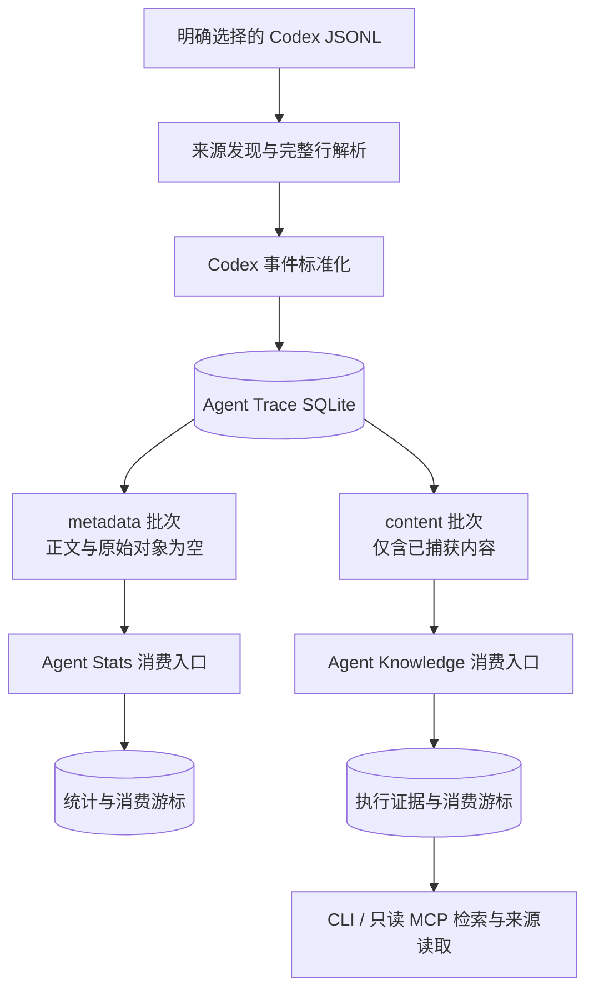

# 架构说明

状态：Codex 首版本地实现；P1 Trace 常驻采集与本机只读 API 已实现，消费方 follow worker 仍属 P2。更新日期：2026-11-14。

本文描述已实现的文件批次链路和 P1 Trace 服务。下一阶段的[无 hook 常驻采集与消费方主动拉取](continuous-collection.md)方案已确认：P0 固定[服务配置](service-config.md)、[本机只读 API](local-api.md)契约和[消费方 follow 约定](consumer-follow.md)，P1 实现 `serve`、扫描调度、租约和 HTTP 服务端；`follow` worker 尚未实现。同步状态留在各消费方，Trace 不负责向 Stats/Knowledge 推送。实施清单见 [TODO](../../TODO.md)。

## 项目职责与数据方向

Agent Trace 保存选定执行过程的证据，并向不同消费方提供同一事件流的不同视图。Agent Stats 生成统计，Agent Knowledge 生成可检索的执行证据投影；自动提取、验证和晋升经验尚未实现。

图中的箭头目前由 CLI 导出/导入 JSON 文件，或由消费方自己的脚本调用 Trace 本机分页 API 完成。P1 的 `serve` 可以独立采集并提供 API，但不会推送或调用下游；Stats/Knowledge 的自动 follow worker 尚未实现。`config-check` 只校验常驻服务配置，不启动采集。Inspector 是独立查看工具，尚未与本模块集成。

| 项目 | 拥有的数据与规则 | 对外入口 |
| --- | --- | --- |
| Agent Trace | 捕获策略、来源、事件身份、事件证据、统一序列、删除标记 | `ingest/export/read/delete-session/status/config-check/serve` |
| Agent Stats | 用量归因、费用估算、工具统计、独立消费进度 | `import-archive`、原有看板和查询 |
| Agent Knowledge | 已授权的归档证据投影、检索、来源读取、独立消费进度 | `archive-import/archive-search/archive-read`、只读 MCP |

消费方通过版本化批次协议协作，不读写 Agent Trace 的内部数据库。Python 与 TypeScript 共享数据契约，各自保留业务算法和存储。

## 模块与源码位置

| 模块 | 源码 | 责任 |
| --- | --- | --- |
| 命令入口 | [src/cli.ts](../src/cli.ts) | 参数校验、命令编排、导入回执、私有批次文件输出 |
| 数据类型与基础校验 | [src/types.ts](../src/types.ts) | 事件/批次类型、身份、时间、哈希和错误 |
| Codex 适配器 | [src/codex.ts](../src/codex.ts) | JSONL 完整行解析、原生记录到统一事件的映射、元数据白名单 |
| Pi 适配器 | [src/pi.ts](../src/pi.ts) | pi session 树到轮次/用量/工具事件的映射；按请求用量合成累计快照与记录成本 |
| 来源与归档存储 | [src/store.ts](../src/store.ts) | 显式路径发现、来源大小检查、事务写入、去重、分页、高水位、读取与删除 |
| 服务配置 | [src/config.ts](../src/config.ts) | 严格配置校验、相对路径解析、项目/cwd 匹配、默认库兼容 |
| 本机 API 契约 | [src/api.ts](../src/api.ts) | 查询与授权校验、错误映射、状态信封、页大小边界 |
| 收集调度 | [src/collector.ts](../src/collector.ts) | 来源发现、项目/cwd 匹配、基线/变化文件重读、单实例租约/心跳、扫描状态 |
| 本机 API 服务端 | [src/server.ts](../src/server.ts) | 回环监听、路由、认证/视图校验、复用 `exportBatch`、二进制页上限 |
| 服务编排 | [src/service.ts](../src/service.ts) | 采集与 API 生命周期、启动/扫描/停止事件、优雅关闭 |
| 跨项目验收 | [scripts/verify-consumers.ts](../scripts/verify-consumers.ts) | 用合成数据调用真实的两侧 CLI |
| 统计消费方 | [agent_stats/archive.py](../../agent-stats/agent_stats/archive.py) | 批次校验、事务游标、统计重建与删除传播 |
| 证据消费方 | [src/archive/index.ts](../../agent-knowledge/src/archive/index.ts) | 事务导入、owner/project 范围、证据搜索和读取 |

首版适配器与存储直接在同一个本地包内协作，尚未建立插件装载框架。后续增加运行时适配器时，应沿用公共事件信封、身份和消费契约；pi/deepseek-harness 的实现不属于当前交付。

## 原始证据、统一事件与投影

一个归档事件包含三个层次：

1. `source` 和 `raw`：来源路径、行号、原行哈希，以及 content 模式捕获的解析对象（已脱敏并可能外置大字符串）。没有保存可独立复原原始空白/编码的完整行字节。
2. `kind/data/body`：统一类型、白名单元数据和便于使用的正文。未知记录保留为 `source.unknown`；content 模式下仍可按事件 ID 读取 `raw`，但其内容不一定进入 Agent Knowledge 的正文检索。
3. 消费方投影：统计结果或可搜索的执行证据。投影可从可用的归档事件重新构建，不能代替归档捕获范围之外的原始资料。

`runtime` 标识 Codex 等运行时，`model` 标识模型；事件原生类型仍保留在 `native_type`。当前不是面向所有运行时的完整模型调用审计系统。

## 归档存储

首版使用 Node.js 内置 SQLite。新默认数据文件为 `.agent-trace/trace.sqlite`；只有新默认库不存在且旧 `.agent-archive/archive.sqlite` 已存在时，才回退到旧库。显式 `--db` 优先。

| 表 | 主要内容 |
| --- | --- |
| `metadata` | 持久的 `archive_id`、捕获模式、标准化版本 |
| `sessions` | 运行时/实例/原生会话身份、固定项目归属和删除状态 |
| `events` | 自增序列、唯一事件 ID、来源哈希与事件负载 |
| `collection_lease/sources/files` | 单实例租约、来源基线/健康状态、文件扫描检查点（不改变事件协议） |

一个文件的事件在同一写事务内提交；CLI 一次选择多个文件时，每个文件独立提交。正常导入是追加式写入，显式删除是清除证据并追加删除标记的例外。文件使用本机私有权限；不提供多用户认证。

Agent Stats 的消费表放在其现有统计库内。Agent Knowledge 的归档证据放在 `<知识库文件>.archive-evidence.sqlite`，与现有知识库分开，避免同步归档导入阻塞同进程异步知识事务。数据文件的完整布局与操作方法见[使用说明](usage.md)。

## 身份与一致性

- 会话身份是 `JSON.stringify([runtime, instance_id, session_id])`，不依赖源文件路径。文件移动或复制后仍能去重。
- Codex 普通事件身份由会话身份和原文件一基行号生成；同位置不同内容视为来源冲突，整文件本次导入回滚。同内容出现在两行是两条证据。
- pi 一个 entry 可产生多个事件，身份由会话身份、entry id、kind 与工具调用 id 生成，不依赖行号；副本和移动保持身份。
- `archive_seq` 表示归档提交顺序；`occurred_at` 表示来源报告时间。没有按时间重排全局事件，也不声明不同运行时的全局因果顺序。
- 每个消费方按 `archive_id` 保存自己的游标，并将事件处理结果和游标原子提交。完整旧页允许重试，跳页和向前延伸的重叠页拒绝。
- 删除标记有专用确定性 ID。消费方校验身份后清除对应投影并记录删除状态，旧页合法重试不会恢复已删除数据。

事件字段及边界以 [v1 协议](protocol.md) 为准。具体时序见[执行流程](workflow.md)。P1 的扫描检查点按来源文件身份记录：导入成功的检查点只在该文件归档事务提交后写入；`backfill=none` 基线和不匹配项目是显式的无导入决策，记录文件版本与项目范围指纹，配置修正后会重试。崩溃后允许整文件重读，不会因检查点提前而漏事件。单归档采集租约存在 `collection_lease`，第二个采集实例会被拒绝，过期租约可接管。

## 捕获与访问边界

`metadata` 是新库默认捕获模式，只保存白名单结构、来源和最多 80 字符的请求标题；这些字段仍可能敏感。`content` 必须在建库时显式启用，才会保存正文和解析对象。模式固定，导出 content 不能补回未捕获的内容。

content 事件在进入归档事务前统一脱敏：常见凭据形态、敏感键值和标题被替换为显式 `[REDACTED:<类别>]`；超过 `content.max_inline_bytes` 的字符串不截断，而是写入权限受限的外置目录，并以带 `bytes`/`sha256` 的 `content_ref` 替换。`record_hash` 仍指向原始源行。外置文件随会话删除或 revision 替换清理；事务回滚可能留下无引用文件，需要目录审计。详见[正文归档](content-capture.md)。

Agent Stats 仅接收 metadata 视图。Agent Knowledge 接收 content 视图，并在导入、搜索和读取时执行 owner/project 范围限制；历史正文始终是待核实证据。当前导出流不做按权限过滤，越权项目会导致 Agent Knowledge 整页拒绝；窄范围部署使用独立归档。

脱敏是启发式保护，不能保证自由散文或私有格式中的密钥不被保存，也不能恢复隐藏推理。删除传播依赖各消费方继续取页；既有导出文件、备份、外置 blob 及其他副本需分别处理。以上是当前实现范围，不代表团队共享权限、自动记忆或安全擦除已经完成。
