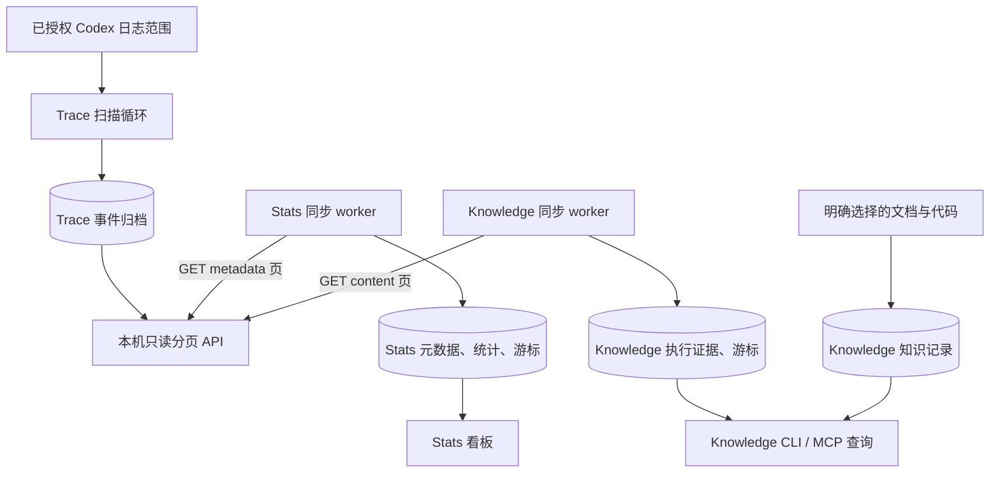
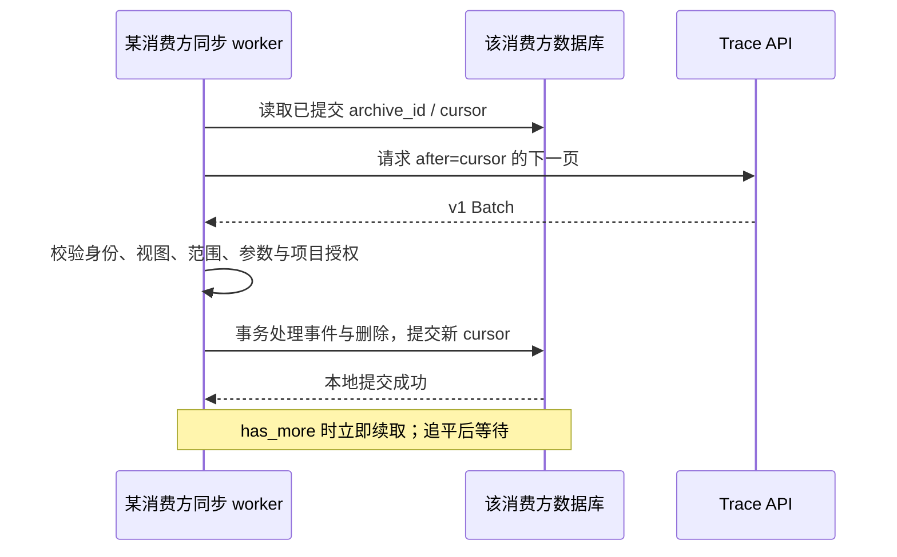

# 常驻采集与消费方主动拉取方案

状态：方案已确认，功能尚未实现。本轮只维护文档，实施交接见工作区 [TODO](../../TODO.md)。更新日期：2026-11-14。

## 已确认的方向

1. 本阶段不用 hook，只接 Codex 持久日志的扫描采集。
2. Trace 常驻采集和归档，提供统一的本机只读事件接口。
3. Stats 和 Knowledge 在各自项目实现自动同步任务，主动拉取 Trace。
4. 同步进度、重试和错误状态由各消费方维护；Trace 不维护目标消费方清单、投递队列或确认游标，不启动它们的命令或进程。
5. 保留现有 CLI 文件导出/导入方式和 v1 事件协议。
6. pi、deepseek-harness、hook、自动经验提取、团队服务和新 UI 均不在本阶段范围。

这取代了此前讨论中的“Trace 向两个项目自动推送”设想。Trace 的采集任务可以独立运行；Stats 的同步无需打开看板，Knowledge 的同步无需保持 MCP 客户端连接。

## 当前与目标

| 能力 | 当前实现 | 本阶段目标 |
| --- | --- | --- |
| Codex 采集 | 手动 `ingest`，整文件读取后去重 | 常驻扫描，发现新文件和变化文件后归档 |
| 事件读取 | CLI 导出 JSON 批次 | 保留 CLI，增加本机只读分页 API |
| Stats 消费 | 手动 `import-archive` | Stats 自己的同步 worker 拉取 metadata |
| Knowledge 消费 | 手动 `archive-import` | Knowledge 自己的同步 worker 拉取 content |
| 同步进度 | 消费库已有事务游标 | 复用游标，补同步任务配置、状态和错误 |
| 删除 | 导出并手动消费墓碑 | 各 worker 自动取到墓碑并清除投影 |

以下出现的 HTTP 接口、配置项、`serve/follow` 等命令均为待实现约定，不是当前可执行能力。

## 目标架构与进程

Trace 只依赖来源配置和自身存储，不导入 Stats 的 Python 实现、不调用 Knowledge CLI、不要求两个消费方启动。消费方只依赖公开协议，不读 Trace 内部表。统一启动脚本若后续添加，只做进程编排，不把跨项目业务依赖塞回 Trace。

当前存储仍按四类 SQLite 文件划分：Trace 原始事件库、Stats 统计库、Knowledge 知识库、Knowledge 证据库。同步数据进入各自已有投影库；不能为了自动同步绕过项目授权或把执行证据自动升级为确认知识。

## Trace：常驻采集

新增前台常驻命令，建议形式为 `agent-trace serve --config PATH`。先通过配置确定：

- 数据库、捕获模式、本机监听地址与端口。
- 明确的日志根目录或文件范围、来源实例 ID。
- 项目 ID 和会话 `cwd` 的允许范围；不匹配的会话跳过并报告。
- 首次启动是否回补已有历史，以及扫描间隔。

Codex 日志目录按日期组织，不能把同一日期目录内的所有会话无条件标成同一项目。来源路径限制与会话项目匹配都必须执行。新增来源或扩大范围需显式配置，真实采集前不根据聊天自行选定全量用户历史。

首版优先复用现有整文件导入器：周期发现新路径，利用文件身份、大小和修改时间判断需要复查的文件，变化后重读并按稳定事件身份去重。只把扫描状态作为优化；归档成功前不能先推进扫描检查点。崩溃后允许重读，不能因此漏掉未提交事件。

继续保留：完整行处理、尾行等待、未知事件、来源冲突整文件回滚、单文件失败不阻塞其他来源、删除会话不自动复活。文件移动到归档目录时同一会话仍去重；源文件消失不自动生成业务删除。采集前已消失的源内容无法恢复。

同一归档应只有一个有效采集调度实例，单文件任务不重入；运行锁/租约的获取、失效恢复和退出清理需要测试。HTTP 读取与 CLI 删除/导入仍服从 SQLite 事务边界。停止信号到来时停止调度新任务、结束已开始事务、关闭监听和数据库。

字节偏移 tail、文件系统通知和更高吞吐优化后置。若以后做偏移读取，必须同时处理会话头、原始行号、半行、文件替换/截断，不能改变既有事件 ID。

## Trace：只读拉取协议

建议以现有 `Archive.exportBatch` 作为 API 的唯一批次生成逻辑：

| 拟定接口 | 行为 |
| --- | --- |
| `GET /v1/events?after=0&limit=500&view=metadata` | 返回现有 v1 Batch，事件按归档序列排序 |
| `GET /v1/status` | 返回协议版本、`archive_id`、捕获模式、当前归档高水位及采集健康状态 |

具体监听端口留给配置，不占用当前 Stats 的 8765。仅监听回环地址；需校验 Host/Origin、请求参数和响应大小，限制可读取视图。metadata 响应始终剔除正文与原始对象。不要把 token 或正文写入访问日志；实施时明确本机客户端凭据/能力与视图授权方案，不因绑定回环地址就假定 content 可以任意访问。

HTTP 返回的批次保留 `schema_version/archive_id/view/after_cursor/next_cursor/has_more/events`，不新增必须由手动导入方理解的字段。`GET` 不推进任何消费状态；重取相同范围没有“确认收货”的副作用。超界游标、非法参数、未授权视图与不可读归档需返回明确错误，不能伪装成空页并让消费方跳过。

首版延续完整流语义，不通过 `project_id` 参数随意过滤全局页。消费者必须获准读取流内所有项目，否则整页拒绝；窄范围使用独立授权归档。未来如需按项目过滤流，另行定义流身份与游标语义。

Trace 不提供消费确认 API，不保存“Stats 已到哪里”等业务状态。它也不能凭自己没有积压信息就清理历史；本阶段不新增自动归档历史清理。删除标记必须按明确保留策略可被离线消费方补取。

## 消费方：独立自动同步

两个项目分别新增自己的 `follow` 类命令或 worker，建议前台独立运行；现有文件导入 CLI 继续保留。每个 worker 的配置包含 Trace URL、允许视图、目标数据库/Knowledge 配置、页大小、空闲轮询间隔、超时及重试边界。

Stats 固定拉 metadata；Knowledge 固定拉 content。不要在原有消费状态中随意切视图。各同步任务只改自己的配置和数据库，不改 Trace 内部表或对方数据。

复用 Stats 的 `import_batch` 和 Knowledge 的 `importBatch`，提取需要的本地进度读取接口。新增同步记录可保存 URL、最近尝试/成功时间、错误和 worker 租约；它们与业务游标分开，不能用内存进度代替已提交游标。

每轮以本地已提交游标为准。HTTP 失败或批次验证失败不推进；事务回滚后从原游标重试。提交后进程退出，即使没有输出成功消息，重启仍读得到新游标。无需 Trace 端持久投递箱或分布式确认事务。

同一个本地消费目标、同一归档/视图只允许一个有效同步任务。重复启动应拒绝或有可验证的串行化机制。网络/临时不可用用有上限的退避重试；协议、身份、项目授权等永久错误停止该同步目标并报告，不能无限快速循环。

若 `archive_id` 变化、游标超出新归档或配置改成另一来源，暂停并要求显式核对，不能静默将游标归零。新建消费库的回放是明确的重建操作；不能把另一归档的同一会话直接覆盖现有 Stats 所有权。

## 两个项目的具体要求

### Agent Stats

- 同步 worker 可独立于看板运行，使用自己的连接和短事务；查询进程应能看到已提交更新。
- 增加明确的 Trace 消费模式。该模式启动和 `/api/refresh` 均不得读取 Codex 日志；页面刷新只刷新已接收统计。
- 当前 `--no-import` 只跳过启动导入，不能当成上述完整消费模式。旧的直接采集模式保留为显式兼容选项，不再作为共享链路的默认行为。
- 同步状态在 Stats 侧展示或输出；Trace 不负责探测 Stats 数据库。

### Agent Knowledge

- 自动拉取 worker 与 MCP 连接生命周期分离；关闭聊天/MCP 不应停止后台同步。
- 保留 owner/project 校验、content 可用性、原始证据引用和知识/证据隔离。
- 与 MCP 并发读写需通过测试，避免锁等待导致整个客户端卡死。复用独立证据数据库，不改回知识库同进程的跨连接长事务。
- 不增加自动经验提取或模型调用；本阶段只让已有证据投影自动更新。

## 状态、删除与保留

Trace 展示采集进度、归档高水位、来源错误与运行心跳；Stats/Knowledge 展示各自的消费游标、最后成功时间及错误。高水位减游标是序号距离，删除会产生空洞，不能直接称为未消费事件数。

删除仍由 Trace 显式执行，消费者下次拉到墓碑时在本地事务清除对应投影。离线期间不承诺即时删除；已经取回但尚未提交的旧页可能先处理，随后必须消费删除标记。额外导出文件、备份及未来缓存按各自规则清理。未知事件、序列空洞和空页推进继续遵守 v1 协议。

## 实施顺序与完成标准

先定义配置与只读接口，完成 Trace 采集/API，再并行完成两个消费方 worker，最后端到端验证。前台稳定后再考虑 macOS launchd 托管；不提前修改全局启动项。

最小完成条件：新日志自动入库、两个消费方无需手工搬页即可更新、独立停机与重启恢复、重复请求不重复计数、事务中断不跳游标、删除传播、Stats Trace 模式不直读日志、MCP 离线不影响 Knowledge 同步、协议/权限错误明确可见。

具体文件、任务与交接提示见 [TODO](../../TODO.md)。
