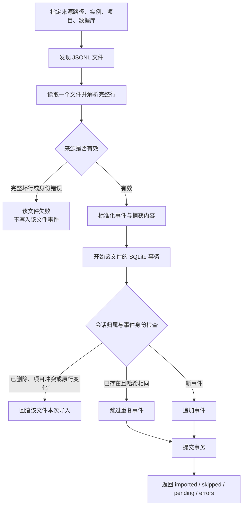
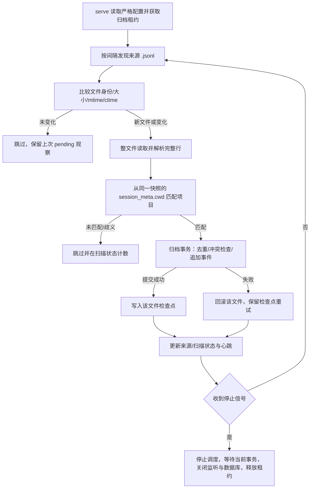
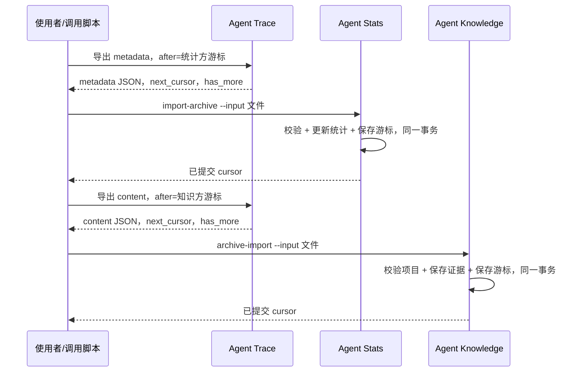
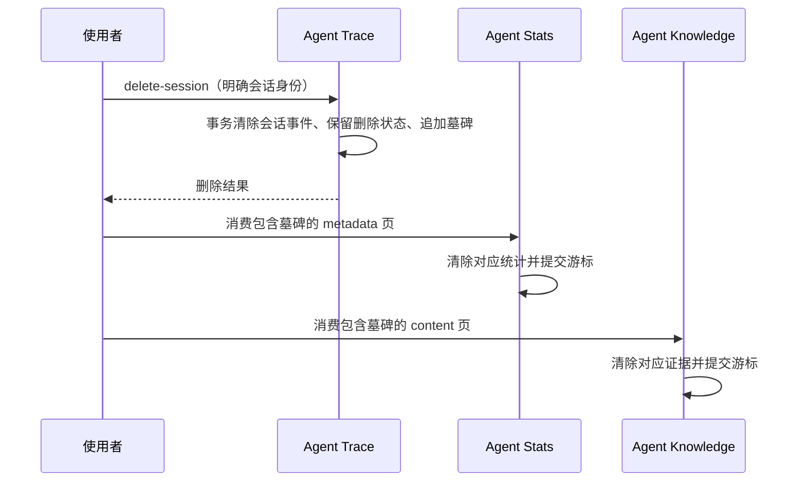

# 执行流程

更新日期：2026-11-14。当前由使用者执行 CLI 驱动，无常驻采集或后台推送。

下文是当前可执行流程：手动批次链路和 P1 Trace 常驻采集/API 均已实现。未来自动消费流程采用[Trace 常驻扫描、消费方各自拉取](continuous-collection.md)，不是 Trace 代替使用者运行下游导入命令；消费方 worker 尚未实现，见 [TODO](../../TODO.md)。

## 1. 来源采集与归档

没有换行结束的尾行被视为未完成，已完成的前缀可以先入库；下一次导入原文件时再接收完整尾行。当前会重读选定文件，通过事件身份去重。源文件消失不会自动删除已保存证据。

一次 CLI 可指定多个来源。进入逐文件导入后，某文件失败不回滚之前成功的文件；回执会列出失败文件，进程以非零状态退出。修复后可重复导入所有同来源文件，已提交事件会被跳过。

### 常驻扫描（P1 `serve`）

首次 `backfill=none` 只记录当前文件的基线身份，不导入既有事件；之后新文件或变化文件整文件导入。`backfill=all` 首次即导入。HTTP API 与扫描共用同一个归档连接，但 `GET` 只调用 `exportBatch`，不推进采集或消费进度。

## 2. 两个消费方独立分页

两个消费方从各自的零游标开始，页大小可以不同。只有消费成功回执中的 `cursor` 才能作为该消费方的下一次 `--after`。`has_more=true` 时继续取页；为 false 时，本次可见前缀已读完，后续导入新事件后再取。

metadata 和 content 共用同一归档序列空间，但不能把一方游标当作另一方进度，也不能在已有消费状态中随意切换视图。消费导出文件不会触发源日志中的命令、网络请求或模型调用。

## 3. 重试与恢复

| 情况 | 当前行为 | 操作 |
| --- | --- | --- |
| 源会话持续追加 | 已存在前缀跳过，新完整行入库 | 再运行同一 `ingest` |
| 导出完成、消费前中断 | 消费方游标未前进 | 提交原导出文件 |
| 消费成功、回执未保存 | 事件和游标已一同提交 | 重试原成功页，读取返回的当前游标 |
| 同一完整页再次提交 | 指纹一致则幂等返回 | 可直接重试 |
| 跳过页或提交向前重叠页 | 拒绝且不推进游标 | 从已确认游标重新导出 |
| 同页身份内容变化 | 拒绝且不推进游标 | 保留原文件，核对来源与导出过程 |
| Agent Knowledge 页中有未授权项目 | 整页拒绝 | 核对本机授权或拆分归档范围，勿手工删事件保留游标 |

导出文件是独立快照。源删除操作发生后，重新导出同一早期范围可能与旧页不同；恢复回执时应重试原成功页，而不是制造一个内容不同的“相同页”。

## 4. 查询与核对证据

Agent Stats 读取其统计投影，可继续使用 `summary` 或 `serve --no-import`。当前 `--no-import` 只跳过启动时导入，页面刷新接口仍可能读取原 Codex 日志；不能把它称为完整的 Trace 只消费模式。共享归档拥有的会话不会被原有直接日志刷新覆盖；统计仍保留未知用量和归因不确定性。完整消费模式属于下一阶段。

Agent Knowledge 的 `archive-search` / MCP `search_archive` 搜索执行证据，返回 `archive_id` 和事件。再用 `archive-read` / `read_archive_event` 读取完整事件和来源定位。它们与活跃知识检索分开，查询成功不表示 agent 的结论已经验证。

Agent Trace 自身也提供 `read --event ID --view content`。原日志删除后，已捕获快照仍能读取；metadata 模式没有捕获的正文不会出现。消费者保存的源行哈希是归档声明，无法只凭 parsed raw 复算原行字节。

## 5. 删除传播

删除和两边投影清除并非跨进程同时完成。停机的消费方在恢复并消费墓碑后清除自身数据；外部导出文件和备份不随之自动消失。

删除造成序列空洞是合法情况，不能把空洞当作缺页。分页仍应使用返回的 `next_cursor`。已删除会话不能被同来源再次导入，消费方也拒绝以新事件复活它；尚无自动恢复或会话迁移命令。

命令实例见[使用与排错](usage.md)，字段定义见 [v1 数据协议](protocol.md)。
